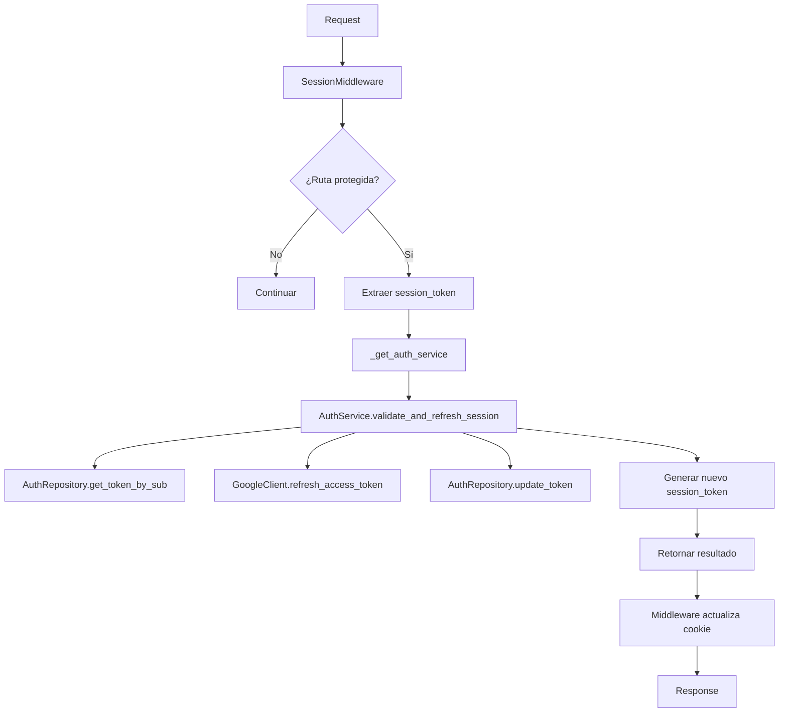

# Arquitectura Mejorada: Middleware con AuthService

## 🎯 **Mejora Arquitectónica**

La refactorización del middleware para usar `AuthService` en lugar de acceder directamente a repositorios sigue mejores principios de arquitectura limpia y separación de responsabilidades.

## 🔧 **Antes vs Después**

### **❌ Diseño Anterior (Problemático)**

```python
class SessionMiddleware(BaseHTTPMiddleware):
    def __init__(self, app):
        super().__init__(app)
        # ❌ Middleware conoce detalles de implementación
        self.auth_repo = AuthRepository()
        self.google_client = GoogleClient()

    async def _check_authentication(self, request: Request) -> dict:
        # ❌ Lógica de negocio en el middleware
        # ❌ Duplicación de código
        # ❌ Violación de SRP
        token_data = await self.auth_repo.get_token_by_sub(user_sub)
        refresh_response = await self.google_client.refresh_access_token(...)
        # ... más lógica de negocio
```

**Problemas:**

-   ❌ **Middleware conoce demasiado** - Conoce `AuthRepository` y `GoogleClient`
-   ❌ **Duplicación de lógica** - Lógica de refresh duplicada
-   ❌ **Violación SRP** - Middleware hace demasiadas cosas
-   ❌ **Acoplamiento fuerte** - Depende de detalles de implementación

### **✅ Diseño Mejorado (Correcto)**

```python
class SessionMiddleware(BaseHTTPMiddleware):
    def __init__(self, app):
        super().__init__(app)
        # ✅ Solo configuración, sin dependencias

    async def dispatch(self, request: Request, call_next):
        # ✅ Middleware solo maneja HTTP
        session_token = request.cookies.get("session_token")

        # ✅ Delega lógica de negocio al servicio
        auth_service = _get_auth_service()
        auth_result = await auth_service.validate_and_refresh_session(session_token)

        # ✅ Solo maneja la respuesta HTTP
        if not auth_result["authenticated"]:
            return JSONResponse(...)
```

**Ventajas:**

-   ✅ **Separación clara** - Middleware solo maneja HTTP
-   ✅ **Reutilización** - Lógica de auth reutilizable
-   ✅ **Testabilidad** - Servicios testeables independientemente
-   ✅ **Mantenibilidad** - Cambios centralizados en servicios

## 🏗️ **Nueva Arquitectura**

### **1. Middleware Simplificado**

```python
class SessionMiddleware(BaseHTTPMiddleware):
    def __init__(self, app, protected_paths: list[str] = None):
        super().__init__(app)
        self.protected_paths = protected_paths or [
            "/api/youtube",
            "/api/user",
        ]
        # ✅ Sin dependencias en el constructor

    async def dispatch(self, request: Request, call_next):
        # ✅ Solo lógica de middleware
        if not self._requires_auth(request.url.path):
            return await call_next(request)

        session_token = request.cookies.get("session_token")
        if not session_token:
            return JSONResponse({"detail": "Session token not found"}, status_code=401)

        # ✅ Delega al servicio
        auth_service = _get_auth_service()
        auth_result = await auth_service.validate_and_refresh_session(session_token)

        # ✅ Solo maneja respuesta HTTP
        if not auth_result["authenticated"]:
            return JSONResponse(
                content={"detail": auth_result["error"]},
                status_code=auth_result["status_code"],
            )

        # ✅ Agrega datos al request
        request.state.user_sub = auth_result["user_sub"]
        request.state.access_token = auth_result["access_token"]
        # ...

        response = await call_next(request)

        # ✅ Actualiza cookie si es necesario
        if auth_result.get("token_refreshed", False):
            self._update_session_cookie(response, ...)

        return response
```

### **2. AuthService con Responsabilidad Completa**

```python
class AuthService:
    def __init__(self, google_client: GoogleClient, auth_repo: AuthRepository):
        self.client = google_client
        self.auth_repo = auth_repo

    async def validate_and_refresh_session(self, session_token: str) -> dict:
        """
        ✅ Método completo que maneja toda la lógica de autenticación:
        - Validación de token de sesión
        - Verificación de expiración
        - Refresh automático de access token
        - Actualización en base de datos
        - Generación de nuevo session token
        """
        try:
            # Decodificar y validar session token
            payload = jwt.decode(session_token, config.jwt_secret, algorithms=["HS256"])

            # Verificar expiración
            if self._is_session_expired(payload):
                return {"authenticated": False, "error": "Session expired", "status_code": 401}

            user_sub = payload.get("sub")
            session_id = payload.get("jti")

            # Obtener datos del token
            token_data = await self.auth_repo.get_token_by_sub(user_sub)
            if not token_data:
                return {"authenticated": False, "error": "Token data not found", "status_code": 401}

            # Verificar y refrescar si es necesario
            if self._is_access_token_expired(token_data):
                refresh_result = await self._refresh_access_token(token_data, user_sub)
                if not refresh_result["success"]:
                    return refresh_result

                token_data = refresh_result["updated_token_data"]
                new_session_token = refresh_result["new_session_token"]
                token_refreshed = True
            else:
                new_session_token = None
                token_refreshed = False

            return {
                "authenticated": True,
                "user_sub": user_sub,
                "session_id": session_id,
                "access_token": token_data.access_token,
                "token_data": token_data,
                "token_refreshed": token_refreshed,
                "new_session_token": new_session_token,
                "refresh_expires_at": token_data.refresh_expires_at,
            }

        except jwt.ExpiredSignatureError:
            return {"authenticated": False, "error": "Session expired", "status_code": 401}
        except jwt.InvalidTokenError:
            return {"authenticated": False, "error": "Invalid session token", "status_code": 401}
        except Exception as e:
            logger.error(f"Error in session validation: {str(e)}")
            return {"authenticated": False, "error": "Authentication error", "status_code": 500}
```

### **3. Factory Function para AuthService**

```python
def _get_auth_service() -> AuthService:
    """✅ Factory function para crear AuthService en el middleware."""
    google_client = GoogleClient()
    auth_repo = AuthRepository()
    return AuthService(google_client, auth_repo)
```

## 📊 **Comparación de Diseños**

| Aspecto             | Diseño Anterior | Diseño Mejorado |
| ------------------- | --------------- | --------------- |
| **Responsabilidad** | ❌ Múltiples    | ✅ Una por capa |
| **Acoplamiento**    | ❌ Fuerte       | ✅ Débil        |
| **Reutilización**   | ❌ Limitada     | ✅ Alta         |
| **Testabilidad**    | ❌ Difícil      | ✅ Fácil        |
| **Mantenibilidad**  | ❌ Compleja     | ✅ Simple       |
| **SOLID**           | ❌ Violado      | ✅ Respetado    |

## 🎯 **Principios Aplicados**

### **1. Single Responsibility Principle (SRP)**

-   ✅ **Middleware** - Solo maneja HTTP y routing
-   ✅ **AuthService** - Solo maneja lógica de autenticación
-   ✅ **AuthRepository** - Solo maneja persistencia
-   ✅ **GoogleClient** - Solo maneja comunicación con Google

### **2. Dependency Inversion Principle (DIP)**

-   ✅ **Middleware** depende de abstracción (`AuthService`)
-   ✅ **AuthService** depende de abstracciones (`AuthRepository`, `GoogleClient`)
-   ✅ **No hay dependencias concretas** en capas superiores

### **3. Open/Closed Principle (OCP)**

-   ✅ **Middleware** cerrado para modificación, abierto para extensión
-   ✅ **AuthService** extensible sin modificar middleware
-   ✅ **Nuevas funcionalidades** se agregan en servicios

### **4. Interface Segregation Principle (ISP)**

-   ✅ **Cada servicio** tiene responsabilidades específicas
-   ✅ **No hay interfaces** innecesariamente grandes
-   ✅ **Dependencias mínimas** entre componentes

## 🔄 **Flujo de Datos Mejorado**



## 🧪 **Ventajas para Testing**

### **1. Middleware Testeable**

```python
def test_middleware_skips_unprotected_routes():
    middleware = SessionMiddleware(app, protected_paths=["/api/protected"])

    # Test que rutas no protegidas pasan sin autenticación
    request = Request({"type": "http", "method": "GET", "url": "/api/public"})
    # No debería llamar a AuthService
```

### **2. AuthService Testeable**

```python
def test_auth_service_refresh_token():
    # Mock de dependencias
    mock_google_client = Mock()
    mock_auth_repo = Mock()

    auth_service = AuthService(mock_google_client, mock_auth_repo)

    # Test lógica de refresh sin middleware
    result = await auth_service.validate_and_refresh_session("valid_token")
    assert result["authenticated"] == True
```

### **3. Testing Independiente**

```python
# ✅ Cada componente se puede testear independientemente
def test_middleware():
    # Solo testea lógica de middleware

def test_auth_service():
    # Solo testea lógica de autenticación

def test_integration():
    # Testea integración completa
```

## 🚀 **Beneficios de la Refactorización**

### **1. Mantenibilidad**

-   ✅ **Cambios centralizados** - Lógica de auth en un solo lugar
-   ✅ **Menos duplicación** - Código reutilizable
-   ✅ **Fácil debugging** - Responsabilidades claras

### **2. Escalabilidad**

-   ✅ **Nuevas funcionalidades** - Se agregan en servicios
-   ✅ **Múltiples middlewares** - Pueden usar el mismo AuthService
-   ✅ **Diferentes interfaces** - AuthService reutilizable

### **3. Testabilidad**

-   ✅ **Unit tests** - Cada componente testeable independientemente
-   ✅ **Integration tests** - Fáciles de escribir
-   ✅ **Mocking** - Dependencias mockeables

### **4. Flexibilidad**

-   ✅ **Diferentes estrategias** - AuthService puede tener múltiples implementaciones
-   ✅ **Configuración** - Fácil cambiar comportamiento
-   ✅ **Extensibilidad** - Nuevas funcionalidades sin modificar middleware

## 📋 **Mejores Prácticas Aplicadas**

### **1. Separación de Responsabilidades**

```python
# ✅ Middleware solo maneja HTTP
class SessionMiddleware:
    async def dispatch(self, request, call_next):
        # Solo lógica de middleware
        pass

# ✅ Servicio maneja lógica de negocio
class AuthService:
    async def validate_and_refresh_session(self, token):
        # Solo lógica de autenticación
        pass
```

### **2. Dependency Injection**

```python
# ✅ Factory function para inyección
def _get_auth_service() -> AuthService:
    return AuthService(GoogleClient(), AuthRepository())
```

### **3. Error Handling Centralizado**

```python
# ✅ Manejo de errores en el servicio
class AuthService:
    async def validate_and_refresh_session(self, token):
        try:
            # Lógica de validación
            pass
        except SpecificException as e:
            return {"authenticated": False, "error": str(e), "status_code": 401}
```

### **4. Logging Consistente**

```python
# ✅ Logging en el nivel apropiado
logger.info(f"Token refreshed for user: {user_sub}")  # En AuthService
logger.warning("Session token expired")  # En AuthService
```

## 🎯 **Conclusión**

La refactorización del middleware para usar `AuthService` proporciona:

-   ✅ **Arquitectura más limpia** - Separación clara de responsabilidades
-   ✅ **Código más mantenible** - Lógica centralizada y reutilizable
-   ✅ **Mejor testabilidad** - Componentes testeables independientemente
-   ✅ **Mayor flexibilidad** - Fácil extensión y modificación
-   ✅ **Principios SOLID** - Diseño que sigue mejores prácticas

**Esta implementación demuestra cómo la arquitectura limpia y la separación de responsabilidades pueden mejorar significativamente la calidad del código y la facilidad de mantenimiento.**
