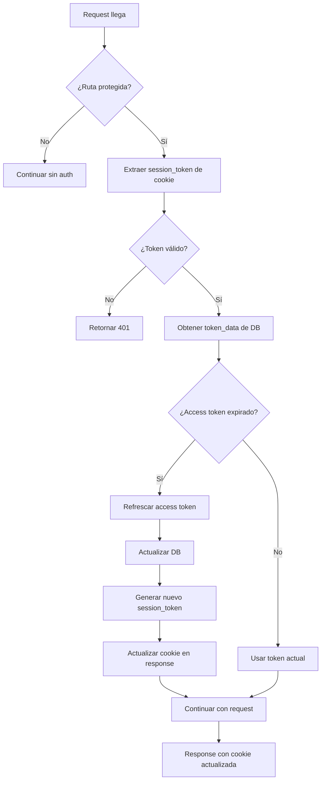

# Middleware con Actualización Automática de Cookies

## 🎯 **Funcionalidad**

El `SessionMiddleware` implementa un sistema completo de autenticación que:

-   ✅ **Verifica tokens** de sesión en rutas protegidas
-   ✅ **Refresca automáticamente** access tokens expirados
-   ✅ **Actualiza cookies** de sesión cuando es necesario
-   ✅ **Maneja errores** de autenticación de forma elegante

## 🔧 **Cómo Funciona**

### **1. Flujo de Autenticación**



### **2. Verificación de Rutas**

```python
protected_paths = [
    "/api/youtube",  # Todas las rutas de YouTube
    "/api/user",     # Todas las rutas de usuario
]

# Rutas públicas (no requieren autenticación):
# - /api/auth/exchange
# - /api/auth/login
# - /api/health
```

### **3. Refresh Automático de Tokens**

```python
# El middleware verifica automáticamente si el access token está expirado
if token_data.expires_at and current_time >= token_data.expires_at:
    # Refrescar usando el refresh token
    refresh_response = await self.google_client.refresh_access_token(
        token_data.refresh_token
    )

    # Actualizar en la base de datos
    await self.auth_repo.update_token(user_sub, update_data)

    # Generar nuevo session token
    new_session_token = jwt.encode({...}, config.jwt_secret)

    # Marcar para actualizar cookie
    token_refreshed = True
```

### **4. Actualización de Cookies**

```python
# Después de procesar la request, si el token fue refrescado:
if auth_result.get("token_refreshed", False):
    self._update_session_cookie(
        response,
        auth_result["new_session_token"],
        auth_result["refresh_expires_at"]
    )
```

## 📋 **Configuración**

### **En main.py**

```python
from src.middlewares.session import SessionMiddleware

def create_app() -> FastAPI:
    app = FastAPI(lifespan=lifespan, title="Youtube Auto Delete API")

    # CORS Middleware
    app.add_middleware(CORSMiddleware, ...)

    # Session Middleware con rutas protegidas
    app.add_middleware(
        SessionMiddleware,
        protected_paths=[
            "/api/youtube",
            "/api/user",
        ]
    )

    return app
```

### **Rutas Protegidas vs Públicas**

| Ruta                 | Protegida | Descripción                |
| -------------------- | --------- | -------------------------- |
| `/api/auth/exchange` | ❌        | Login público              |
| `/api/auth/login`    | ❌        | Login público              |
| `/api/health`        | ❌        | Health check público       |
| `/api/youtube/*`     | ✅        | Todas las rutas de YouTube |
| `/api/user/*`        | ✅        | Todas las rutas de usuario |

## 🔄 **Flujo de Refresh de Token**

### **1. Request con Token Expirado**

```http
GET /api/youtube/playlists
Cookie: session_token=eyJ0eXAiOiJKV1QiLCJhbGciOiJIUzI1NiJ9...
```

### **2. Middleware Detecta Expiración**

```python
# El middleware verifica:
current_time = datetime.now(timezone.utc).timestamp()
if token_data.expires_at and current_time >= token_data.expires_at:
    # Token expirado, necesita refresh
```

### **3. Refresh Automático**

```python
# Llama a Google para refrescar
refresh_response = await self.google_client.refresh_access_token(
    token_data.refresh_token
)

# Actualiza en DynamoDB
update_data = {
    "access_token": refresh_response.access_token,
    "expires_at": int(time.time()) + refresh_response.expires_in,
    "issued_at": int(time.time()),
}
await self.auth_repo.update_token(user_sub, update_data)
```

### **4. Nueva Cookie de Sesión**

```python
# Genera nuevo session token
new_session_token = jwt.encode({
    "sub": user_sub,
    "jti": session_id,
    "iat": int(time.time()),
    "exp": int(time.time()) + 3600,  # 1 hora
}, config.jwt_secret, algorithm="HS256")

# Actualiza la cookie en la response
response.set_cookie(
    key="session_token",
    value=new_session_token,
    httponly=True,
    secure=True,
    samesite="strict",
    max_age=max_age,
    path="/",
)
```

### **5. Response con Cookie Actualizada**

```http
HTTP/1.1 200 OK
Set-Cookie: session_token=eyJ0eXAiOiJKV1QiLCJhbGciOiJIUzI1NiJ9...; HttpOnly; Secure; SameSite=strict; Max-Age=3600; Path=/
Content-Type: application/json

{
  "items": [...],
  "total_results": 25
}
```

## 🎯 **Ventajas de esta Implementación**

### **1. Transparente para el Usuario**

-   ✅ **Sin interrupciones** - El usuario no nota el refresh
-   ✅ **Sin re-login** - No necesita volver a autenticarse
-   ✅ **Experiencia fluida** - Las requests continúan normalmente

### **2. Automático y Robusto**

-   ✅ **Refresh automático** - No requiere intervención manual
-   ✅ **Manejo de errores** - Gestiona fallos de refresh elegantly
-   ✅ **Logging completo** - Registra todos los eventos importantes

### **3. Seguro**

-   ✅ **Tokens seguros** - HttpOnly, Secure, SameSite cookies
-   ✅ **Expiración correcta** - Max-age basado en refresh token
-   ✅ **Validación completa** - Verifica todos los tokens

### **4. Eficiente**

-   ✅ **Solo cuando es necesario** - Solo refresca tokens expirados
-   ✅ **Cache de tokens** - Evita refreshes innecesarios
-   ✅ **Rutas condicionales** - Solo procesa rutas protegidas

## 📊 **Estados del Request**

### **Request State Variables**

```python
# Después del middleware, el request.state contiene:
request.state.user_sub          # ID del usuario
request.state.session_id        # ID de la sesión
request.state.access_token      # Access token válido
request.state.token_data        # Datos completos del token
request.state.token_refreshed   # True si se refrescó el token
request.state.new_session_token # Nuevo session token (si se refrescó)
```

### **Uso en Endpoints**

```python
@router.get("/youtube/playlists")
async def get_playlists(
    request: Request,
    youtube_service: YoutubeService = Depends(get_youtube_service_for_user)
):
    # El middleware ya verificó la autenticación
    # request.state.access_token ya está disponible y es válido
    return await youtube_service.get_user_playlists()
```

## ⚠️ **Manejo de Errores**

### **1. Token de Sesión Expirado**

```json
{
    "detail": "Session expired"
}
```

**Status:** 401 Unauthorized

### **2. Token de Sesión Inválido**

```json
{
    "detail": "Invalid session token"
}
```

**Status:** 401 Unauthorized

### **3. Ambos Tokens Expirados**

```json
{
    "detail": "Both access and refresh tokens expired. Please re-authenticate."
}
```

**Status:** 401 Unauthorized

### **4. Error en Refresh**

```json
{
    "detail": "Failed to refresh access token. Please re-authenticate."
}
```

**Status:** 401 Unauthorized

### **5. Error General**

```json
{
    "detail": "Authentication error"
}
```

**Status:** 500 Internal Server Error

## 🔍 **Logging y Debugging**

### **Logs del Middleware**

```python
# Logs importantes:
logger.info(f"Access token expired for user: {user_sub}, refreshing...")
logger.info(f"Successfully refreshed access token for user: {user_sub}")
logger.info("Session cookie updated after token refresh")
logger.warning(f"No token data found for user: {user_sub}")
logger.error(f"Failed to refresh token for user {user_sub}: {str(e)}")
```

### **Debugging**

```python
# Para debuggear, puedes agregar logs adicionales:
logger.debug(f"Request path: {request.url.path}")
logger.debug(f"Requires auth: {self._requires_auth(request.url.path)}")
logger.debug(f"Token refreshed: {token_refreshed}")
logger.debug(f"New session token generated: {new_session_token is not None}")
```

## 🚀 **Ejemplos de Uso**

### **Frontend JavaScript**

```javascript
// El frontend no necesita manejar refresh manualmente
async function getPlaylists() {
    const response = await fetch('/api/youtube/playlists', {
        credentials: 'include', // Envía cookies automáticamente
    })

    // Si el token fue refrescado, la cookie se actualiza automáticamente
    return response.json()
}

// El middleware maneja todo automáticamente:
// 1. Verifica la cookie de sesión
// 2. Refresca el access token si es necesario
// 3. Actualiza la cookie con el nuevo session token
// 4. La próxima request usa la cookie actualizada
```

### **Testing**

```python
# En tests, puedes verificar que el middleware funciona:
def test_token_refresh():
    # Simular token expirado
    expired_token = create_expired_session_token()

    # Hacer request
    response = client.get("/api/youtube/playlists", cookies={"session_token": expired_token})

    # Verificar que se refrescó automáticamente
    assert response.status_code == 200
    assert "session_token" in response.cookies
    assert response.cookies["session_token"] != expired_token
```

## 📈 **Métricas y Monitoreo**

### **Métricas Importantes**

-   **Token Refresh Rate** - Frecuencia de refreshes
-   **Authentication Success Rate** - Tasa de éxito de autenticación
-   **Session Duration** - Duración promedio de sesiones
-   **Error Rates** - Tasa de errores por tipo

### **Alertas Recomendadas**

-   🔴 **High refresh rate** - Muchos refreshes pueden indicar problemas
-   🔴 **Authentication failures** - Fallos de autenticación
-   🔴 **Token expiration errors** - Errores de expiración
-   🟡 **Session timeouts** - Sesiones que expiran frecuentemente

## 🔗 **Integración con Otros Servicios**

### **YouTube Service**

```python
# El YoutubeService ya no necesita manejar refresh:
class YoutubeService:
    def __init__(self, google_client, auth_repo, user_sub, access_token):
        # El access_token ya viene válido del middleware
        self._access_token = access_token
        self._youtube_client = build("youtube", "v3", credentials=Credentials(access_token))
```

### **Auth Service**

```python
# El AuthService se simplifica:
class AuthService:
    # Ya no necesita métodos de refresh
    # El middleware maneja todo automáticamente
    pass
```

## 💡 **Mejores Prácticas**

### **1. Configuración de Cookies**

```python
# Configuración segura de cookies:
response.set_cookie(
    key="session_token",
    value=session_token,
    httponly=True,      # No accesible desde JavaScript
    secure=True,        # Solo HTTPS
    samesite="strict",  # Protección CSRF
    max_age=max_age,   # Basado en refresh token
    path="/",          # Disponible en toda la app
)
```

### **2. Manejo de Errores**

```python
# Siempre manejar errores de forma elegante:
try:
    # Operación de refresh
    pass
except Exception as e:
    logger.error(f"Failed to refresh token: {str(e)}")
    return {
        "authenticated": False,
        "error": "Please re-authenticate",
        "status_code": 401
    }
```

### **3. Logging**

```python
# Logs informativos pero no excesivos:
logger.info(f"Token refreshed for user: {user_sub}")
logger.warning(f"Session expired for user: {user_sub}")
logger.error(f"Authentication failed: {str(e)}")
```

## 🎯 **Conclusión**

El `SessionMiddleware` con actualización automática de cookies proporciona:

-   ✅ **Experiencia de usuario fluida** - Sin interrupciones por tokens expirados
-   ✅ **Seguridad robusta** - Manejo seguro de tokens y cookies
-   ✅ **Mantenimiento mínimo** - Automático y transparente
-   ✅ **Escalabilidad** - Eficiente y optimizado
-   ✅ **Debugging fácil** - Logs completos y métricas

**Esta implementación elimina la necesidad de manejar refresh de tokens manualmente en el frontend o en los servicios, proporcionando una experiencia de autenticación completamente transparente.**
